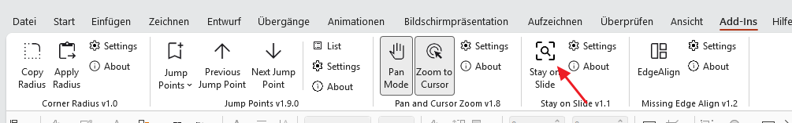

# PowerPoint PowerTools 🚀
> Eine durchdachte Suite moderner VSTO-Add-Ins für Microsoft PowerPoint Desktop zur Steigerung von Produktivität, Layout-Präzision, Navigation und Leinwand-Kontrolle.



---

## 📦 Die 5 PowerTools im Überblick

Alle 5 Add-Ins fügen sich harmonisch nebeneinander in den PowerPoint-Reiter **Add-Ins** ein und folgen einem einheitlichen Designstandard (Google Material Symbols Outlined, normierte 30×30 px Icondimensionen, High-DPI-fähig, Quick Access Toolbar kompatibel).

| Add-In | Version | Hauptfunktionen | Ribbon-Befehle |
| :--- | :---: | :--- | :--- |
| **Corner Radius** | `v1.0` | Überträgt den absoluten Eckenradius (in Points/Pixeln) von einer Form auf andere, unabhängig von deren Dimensionen. | `Copy Radius`, `Apply Radius`, `Settings`, `About` |
| **Jump Points** | `v1.9.0` | Bookmark-Navigation wie in IDEs: Schnelles Springen zwischen definierten Folien über die Leiste, Navigator-Fenster oder QAT-Shortcuts. | `Jump Points` (Split), `Previous Jump Point`, `Next Jump Point`, `List`, `Settings`, `About` |
| **Pan & Cursor Zoom** | `v1.8` | Flüssiges Verschieben der Folie (Pan Mode / Handwerkzeug) und zentriertes Zoomen direkt auf den Mauszeiger. | `Pan Mode`, `Zoom to Cursor`, `Settings`, `About` |
| **Stay on Slide** | `v1.1` | Verhindert versehentliches Wechseln der Folie beim Scrollen (Hard-Stop an den Rändern), erhält Objekt-Markierungen und bietet einen erweiterten Montagebereich. | `Stay on Slide`, `Settings`, `About` |
| **Missing Edge Align** | `v1.2` | Präzises Ausrichten von Formen an den Folienkanten und Nachbarobjekten. | `EdgeAlign`, `Settings`, `About` |

---

## 🛠️ Schnellinstallation

Jedes Add-In verfügt über ein eigenes ClickOnce-Installationspaket im Ordner [`releases/`](releases/):

1. Navigieren Sie in den gewünschten Ordner unter `releases/` (z. B. `PowerPointStayOnSlidePointsAddIn_V1.1_RELEASE`).
2. Doppelklicken Sie auf die mitgelieferte Datei **`Bereinigen_und_Installieren.cmd`**.
   * Diese schließt PowerPoint sauber, bereinigt eventuell veraltete VSTO-Cache-Einträge und führt `setup.exe` aus.
3. Starten Sie PowerPoint – das neue Werkzeug erscheint sofort im Reiter **Add-Ins**.

Alternativ liegen unter `releases/` auch alle gepackten **`.zip`-Dateien** für die einfache Weitergabe bereit.

---

## 💻 Aus dem Quellcode bauen

Die Suite ist als Monorepo aufgebaut und kann mit einer einzigen Solution geöffnet und gebaut werden:

1. **Voraussetzungen:**
   * Visual Studio 2022 (Community, Professional oder Enterprise)
   * Workload: *Entwicklung für Office/SharePoint* (VSTO)
   * .NET Framework 4.8 Entwicklerpaket
2. **Kompilieren:**
   * Öffnen Sie [`PowerPointPowerTools.sln`](PowerPointPowerTools.sln) in Visual Studio 2022.
   * Drücken Sie `Strg + Umschalt + B` (oder wählen Sie *Erstellen -> Projektmappe erstellen*).
   * Alle 5 Projekte werden fehlerfrei gebaut und verweisen auf die entsprechenden VSTO-Assemblys.

```powershell
# Alternativ über die Entwickler-Eingabeaufforderung / MSBuild:
msbuild PowerPointPowerTools.sln /p:Configuration=Release
```

---

## 📂 Repository-Struktur

```text
PowerPoint-PowerTools/
├── .gitignore                          # Visual Studio & VSTO Ausschlussregeln
├── LICENSE                             # MIT Lizenz
├── README.md                           # Dokumentation & Übersicht
├── PowerPointPowerTools.sln            # Zentrale Projektmappe für alle 5 Add-Ins
├── Build-Releases.ps1                  # Automatisiertes Build-, Publish- & ZIP-Skript
├── docs/
│   └── ribbon-preview.png              # Screenshot des Add-Ins-Reiters
├── src/
│   ├── PowerPointCornerRadiusPointsAddIn/   # Quellcode: Corner Radius v1.0
│   ├── PowerPointJumpPointsAddIn/           # Quellcode: Jump Points v1.9/v2.0
│   ├── PowerPointMissingEdgeAlignAddIn/     # Quellcode: Missing Edge Align v1.2
│   ├── PowerPointPanZoomAddIn/              # Quellcode: Pan and Cursor Zoom v1.8
│   └── PowerPointStayOnSlidePointsAddIn/    # Quellcode: Stay on Slide v1.1
└── releases/
    ├── PowerPointCornerRadiusPointsAddIn_V1.0_RELEASE/ (und .zip)
    ├── PowerPointJumpPointsAddIn_V2.0_RELEASE/         (und .zip)
    ├── PowerPointMissingEdgeAlignAddIn_V1.2_RELEASE/   (und .zip)
    ├── PowerPointPanZoomAddIn_V1.8_RELEASE/            (und .zip)
    └── PowerPointStayOnSlidePointsAddIn_V1.1_RELEASE/  (und .zip)
```

---

## 🎨 Design- & UX-Prinzipien

* **Google Material Symbols:** Klare, moderne Icons mit konsistentem visuellen Gewicht.
* **Normiertes Spacing:** Alle großen Buttons besitzen eine Kern-Icongröße von 30×30 px mit 9 px optischem Puffer auf 48×48 Canvas.
* **QAT-Freundlich:** Alle Hauptbefehle können per Rechtsklick zur *Symbolleiste für den Schnellzugriff* (Quick Access Toolbar) hinzugefügt werden, um über `Alt + [Nummer]` sekundenschnell bedient zu werden.
* **Unterbrechungsfrei:** Entwickelt für den anspruchsvollen professionellen Arbeitsalltag ohne störende Seiteneffekte auf native PowerPoint-Mechaniken.

---

## 📄 Lizenz

Dieses Projekt ist unter der [MIT-Lizenz](LICENSE) lizenziert.  
© 2026 **Sperker.Training**. Alle Rechte vorbehalten.
